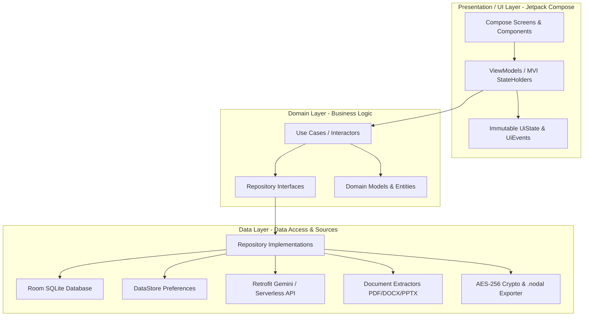
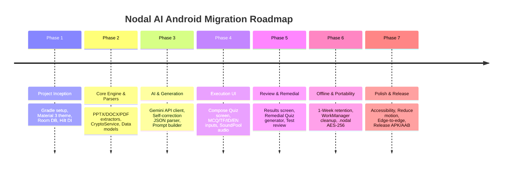

# Nodal AI — Native Android Architecture & Rebuild Blueprint
**Target IDE:** Android Studio (Ladybug / Iguana or newer)  
**Language:** Kotlin 2.0+  
**UI Framework:** Jetpack Compose (Material Design 3)  
**Architectural Pattern:** Modern Android Architecture (Clean Architecture + MVI/MVVM with Unidirectional Data Flow)  
**Target SDK:** Android 15 (API 35) | **Minimum SDK:** Android 11.0 (API 30)  
**Document Version:** 1.0.0 (Production Migration Specification)

---

## 1. Executive Summary & Migration Objective

This specification provides the comprehensive engineering blueprint to rebuild the **Nodal AI** web application (`nodalai-genwebapp`) into a high-performance, native Android application.

Nodal AI is a privacy-first, client-driven interactive study companion and assessment platform. It transforms study documents (PDFs, Word documents, PowerPoint presentations, plain text) or external AI prompts into tailored, interactive quizzes with instant audio feedback, remedial testing, 1-week offline retention, longitudinal statistics, and AES-256 encrypted backups (`.nodal`).

This blueprint serves as an executable specification for Android Studio and its AI coding assistants (Gemini in Android Studio, Copilot, etc.), detailing every data model, Room database schema, document extraction pipeline, AI generation prompt, audio synthesis mechanic, and Jetpack Compose screen.

---

## 2. Recommended Android Tech Stack

| Layer / Component | Technology | Rationale |
| :--- | :--- | :--- |
| **Language** | Kotlin 2.1+ | Modern, concise, coroutines, type safety, multiplatform-ready. |
| **UI Toolkit** | Jetpack Compose + Material 3 (Material You) | Declarative UI, dynamic theme coloring, smooth 60/120fps hardware-accelerated animations. |
| **Architecture** | Clean Architecture (UI, Domain, Data) + MVI / MVVM | Strict unidirectional data flow (`StateFlow`), testability, separation of concerns. |
| **Dependency Injection**| Hilt (`com.google.dagger:hilt-android`) | Standard Android DI, ViewModel lifecycle integration. |
| **Local Persistence** | Room Database (`androidx.room`) | SQLite object mapping, reactive queries via `Flow`, ACID compliance. |
| **Key-Value Storage** | Jetpack DataStore (Preferences) | Replaces `SharedPreferences` for user settings, dark mode, reduce motion, sound toggles. |
| **Encrypted Storage** | AndroidX Security Crypto (`MasterKey`, `EncryptedSharedPreferences`) + `javax.crypto` | AES-256 GCM encryption matching web app's `.nodal` file format. |
| **Networking** | OkHttp 4.12+ & Retrofit 2.11+ / Ktor Client | High-performance HTTP client for Vercel Serverless Function and Google Gemini API. |
| **AI Integration** | Google Generative AI SDK for Android (`com.google.ai.client.generativeai`) OR Retrofit to Serverless | Direct on-device Gemini API access or proxying through existing Vercel backend (`/api/generate-quiz`). |
| **Document Parsing** | `PdfRenderer` + Apache POI lightweight / `java.util.zip` | Zero-external-server document extraction (PPTX XML via `ZipInputStream`, DOCX via POI/XML, PDF via Android native APIs). |
| **Audio Engine** | `SoundPool` / `ToneGenerator` / `ExoPlayer` (Media3) | Low-latency harmonic chimes for correct/incorrect answers. |
| **Background Tasks** | AndroidX WorkManager | Automatic 1-week offline retention pruning, background cloud sync. |
| **Navigation** | Jetpack Navigation Compose (Type-Safe Navigation 2.8+) | Kotlin serialization-based type-safe destination routing. |
| **JSON Serialization**| Kotlinx Serialization (`kotlinx-serialization-json`) | High-speed reflection-free JSON parsing for quiz import/export. |

---

## 3. System Architecture & Package Structure



### Complete Project Package Structure
```
com.nodalai.app/
├── NodalApplication.kt
├── di/
│   ├── AppModule.kt
│   ├── DatabaseModule.kt
│   ├── NetworkModule.kt
│   └── RepositoryModule.kt
├── data/
│   ├── local/
│   │   ├── NodalDatabase.kt
│   │   ├── dao/
│   │   │   ├── QuizDao.kt
│   │   │   ├── QuizTakeDao.kt
│   │   │   └── OfflineDownloadDao.kt
│   │   ├── entity/
│   │   │   ├── QuizEntity.kt
│   │   │   ├── QuestionEntity.kt
│   │   │   ├── QuizTakeEntity.kt
│   │   │   └── OfflineDownloadEntity.kt
│   │   └── converter/
│   │       └── Converters.kt
│   ├── remote/
│   │   ├── GeminiApiService.kt
│   │   ├── ServerlessQuizService.kt
│   │   └── dto/
│   │       ├── GenerateQuizRequest.kt
│   │       ├── GenerateQuizResponse.kt
│   │       └── GeminiRawResponse.kt
│   ├── parser/
│   │   ├── DocumentParserManager.kt
│   │   ├── PdfExtractor.kt
│   │   ├── PptxExtractor.kt
│   │   ├── DocxExtractor.kt
│   │   └── PlainTextExtractor.kt
│   ├── crypto/
│   │   └── NodalCryptoService.kt
│   ├── preferences/
│   │   └── UserPreferencesRepository.kt
│   └── repository/
│       ├── QuizRepositoryImpl.kt
│       ├── QuizHistoryRepositoryImpl.kt
│       ├── OfflineStorageRepositoryImpl.kt
│       └── DocumentRepositoryImpl.kt
├── domain/
│   ├── model/
│   │   ├── Quiz.kt
│   │   ├── Question.kt
│   │   ├── QuestionType.kt
│   │   ├── QuizConfig.kt
│   │   ├── QuizTake.kt
│   │   ├── UserAnswerRecord.kt
│   │   └── OfflineDownload.kt
│   ├── repository/
│   │   ├── QuizRepository.kt
│   │   ├── QuizHistoryRepository.kt
│   │   ├── OfflineStorageRepository.kt
│   │   └── DocumentRepository.kt
│   └── usecase/
│       ├── GenerateQuizUseCase.kt
│       ├── GenerateRemedialQuizUseCase.kt
│       ├── EvaluateAnswerUseCase.kt
│       ├── ParseDocumentsUseCase.kt
│       ├── ImportQuizUseCase.kt
│       ├── ExportNodalBackupUseCase.kt
│       ├── CalculateStatisticsUseCase.kt
│       └── CleanExpiredDownloadsUseCase.kt
├── ui/
│   ├── theme/
│   │   ├── Color.kt
│   │   ├── Theme.kt
│   │   ├── Type.kt
│   │   └── Shape.kt
│   ├── navigation/
│   │   ├── NavRoutes.kt
│   │   └── NodalNavHost.kt
│   ├── audio/
│   │   └── QuizAudioFeedback.kt
│   ├── components/
│   │   ├── NodalAppBar.kt
│   │   ├── NodalTimerBar.kt
│   │   ├── QuestionTypeBadge.kt
│   │   ├── DifficultyBadge.kt
│   │   ├── ImportChoiceDialog.kt
│   │   ├── PasteJsonDialog.kt
│   │   ├── UnansweredWarningDialog.kt
│   │   ├── NodalConfirmDialog.kt
│   │   └── NodalBottomSheet.kt
│   ├── screens/
│   │   ├── home/
│   │   │   ├── HomeScreen.kt
│   │   │   ├── HomeViewModel.kt
│   │   │   └── HomeUiState.kt
│   │   ├── customize/
│   │   │   ├── CustomizeQuizScreen.kt
│   │   │   ├── CustomizeViewModel.kt
│   │   │   └── CustomizeUiState.kt
│   │   ├── generation/
│   │   │   ├── GenerationLoadingScreen.kt
│   │   │   ├── GenerationViewModel.kt
│   │   │   └── GenerationUiState.kt
│   │   ├── quiz/
│   │   │   ├── QuizExecutionScreen.kt
│   │   │   ├── QuizViewModel.kt
│   │   │   ├── QuizUiState.kt
│   │   │   └── components/
│   │   │       ├── MultipleChoiceView.kt
│   │   │       ├── TrueFalseView.kt
│   │   │       ├── IdentificationView.kt
│   │   │       ├── EnumerationView.kt
│   │   │       └── QuestionDrawer.kt
│   │   ├── results/
│   │   │   ├── ResultsScreen.kt
│   │   │   ├── ResultsViewModel.kt
│   │   │   └── ResultsUiState.kt
│   │   ├── review/
│   │   │   ├── TestReviewScreen.kt
│   │   │   └── TestReviewViewModel.kt
│   │   ├── library/
│   │   │   ├── LibraryScreen.kt
│   │   │   └── LibraryViewModel.kt
│   │   ├── statistics/
│   │   │   ├── StatisticsScreen.kt
│   │   │   └── StatisticsViewModel.kt
│   │   ├── downloads/
│   │   │   ├── DownloadsScreen.kt
│   │   │   └── DownloadsViewModel.kt
│   │   └── account/
│   │       ├── AccountSettingsScreen.kt
│   │       └── AccountViewModel.kt
└── worker/
    └── ExpiredOfflineCleanupWorker.kt
```

---

## 4. Complete Feature Specification & Logic Mapping

### 4.1 Document Ingestion & Local Parsing Pipeline
In the web version, `fileHandling.js` uses `pdf.js`, `mammoth.js`, and `JSZip`. In Android, all processing must happen locally on a background IO Coroutine thread without uploading documents to any remote server:

1. **PowerPoint (.pptx)**:
   - Use `java.util.zip.ZipInputStream` to open the `.pptx` archive.
   - Iterate entries matching `ppt/slides/slide[0-9]+.xml`.
   - Parse XML using `XmlPullParser` or regex to extract all text within `<a:t>...</a:t>` tags.
   - Separate slide titles and body bullet hierarchies.
   - *Advantage:* Zero third-party dependency weight! Fast, resilient, 100% offline.
2. **Microsoft Word (.docx)**:
   - Open using `java.util.zip.ZipInputStream`.
   - Extract `word/document.xml`.
   - Extract text within `<w:t>...</w:t>` tags, preserving paragraph breaks from `<w:p>`.
3. **PDF Documents (.pdf)**:
   - Use Android native `android.graphics.pdf.PdfRenderer` (for rendering) combined with `com.tom-roush:pdfbox-android:2.0.27.0` for full text extraction across all pages.
4. **Plain Text & Markdown (.txt, .md, .rtf, .csv)**:
   - Standard Kotlin `InputStream.bufferedReader().use { it.readText() }`.
5. **Multi-File Aggregator**:
   - Allows users to select multiple documents using Android's `ActivityResultContracts.OpenMultipleDocuments()`.
   - Caches parsed text per file URI in an in-memory `LruCache` to avoid re-parsing when adjusting settings.
   - Combines document texts into a unified study set with clear headers:
     `=== [File 1: Lecture_1.pptx] ===\n...content...\n=== [File 2: Syllabus.pdf] ===\n...`

### 4.2 Quiz Configuration Engine
Matches web configuration parameters:
- **Question Count**: Integer between 1 and 100 (default: 10, presets: 5, 10, 15, 20, 30, 50, custom).
- **Difficulty**: `EASY`, `MEDIUM`, `HARD`, `CUSTOM`.
- **Question Formats**:
  - `MULTIPLE_CHOICE`: 4 options (1 correct, 3 distractors).
  - `TRUE_OR_FALSE`: 2 options (True, False).
  - `IDENTIFICATION`: Free-form text input with case-insensitive, whitespace-trimmed evaluation.
  - `ENUMERATION`: Multi-item answers (order-independent set matching).
  - `MIXED`: Balanced ratio (e.g. 40% MCQ, 20% T/F, 20% ID, 20% EN).
- **Timer Modes**:
  - `TOTAL_QUIZ_TIME`: Global countdown timer (e.g., 10 minutes total).
  - `PER_QUESTION_TIME`: Per-question countdown (e.g., 30s or 60s per item).
  - `UNTIMED`: Practice mode without clock pressure.
- **Attempt Restrictions**: Unlimited vs Maximum attempts (e.g., 1 to 5 attempts).
- **Behavioral Toggles**:
  - `showAnswersInSummaryOnly`: Strict exam mode (no explanations during the test).
  - `enableSecondChance`: Allow 1 retry on incorrect answer before locking.
  - `randomizeQuestions`: Shuffle question sequence.
  - `randomizeChoices`: Shuffle multiple choice options.
  - `allowChangeSelection`: Can modify selected answer before navigating next.
  - `uiMode`: Modern (clean card, floating HUD) vs Classic (traditional form list).

### 4.3 AI Generation & Self-Correction Pipeline
Matches `api/generate-quiz.js` and `scripts/quiz/quizGeneration.js`:
- **Model Target**: Google Gemini 3.5 Flash-Lite (`gemini-3.5-flash-lite` or `gemini-2.5-flash`).
- **System Prompt Specification**:
  ```markdown
  Instructional Specification: JSON Quiz Generator
  Role & Task: Act as an expert instructional designer and JSON architect. Generate a quiz based strictly on the provided text reviewer.
  CRITICAL: You MUST provide the generated quiz enclosed entirely within a single clean ```json code block. Do NOT output conversational text, preambles, or summaries.
  
  JSON Schema:
  {
    "fileName": "String",
    "config": {
      "count": Int,
      "difficulty": "easy"|"medium"|"hard",
      "mc": Int,
      "tf": Int,
      "id": Int,
      "en": Int,
      "customType": "multiple-choice"|"true-or-false"|"identification"|"enumeration"|"mixed",
      "customTypeShort": "String",
      "uiMode": "modern"|"classic",
      "isTimed": Boolean,
      "totalTime": Int,
      "isAttemptLimited": Boolean,
      "maxAttempts": Int,
      "showAnswersInSummaryOnly": Boolean,
      "isRemedial": Boolean
    },
    "questions": [
      {
        "type": "multiple-choice",
        "question": "String",
        "options": ["Option A", "Option B", "Option C", "Option D"],
        "answer": "Option A",
        "explanation": "String"
      },
      {
        "type": "true-or-false",
        "question": "String",
        "options": ["True", "False"],
        "answer": "True",
        "explanation": "String"
      },
      {
        "type": "identification",
        "question": "String",
        "options": [],
        "answer": "String",
        "explanation": "String"
      },
      {
        "type": "enumeration",
        "question": "String",
        "options": [],
        "answer": ["Item 1", "Item 2", "Item 3"],
        "explanation": "String"
      }
    ]
  }
  ```
- **Self-Correction & Resiliency Loop**:
  1. Parse JSON response using Kotlinx Serialization.
  2. If JSON is wrapped in markdown (````json ... ````), strip formatting.
  3. Validate question count: If AI returned fewer items than requested, trigger a surgical supplementary prompt asking Gemini for only the missing question indices.
  4. Truncate excess questions if Gemini generated more than requested.
  5. Fallback Prompt Generator: If network fails or user is offline, allow user to copy the generated system prompt to clipboard to run in any web LLM, then paste the resulting JSON back via the Import Modal.

### 4.4 Quiz Execution Engine
- **Evaluation Logic (`evaluateAnswer`)**:
  - `MULTIPLE_CHOICE` & `TRUE_OR_FALSE`: Normalized lowercase trimmed equality (`userAnswer.trim().lowercase() == question.answer.trim().lowercase()`).
  - `IDENTIFICATION`: Case-insensitive, whitespace-collapsed string equality.
  - `ENUMERATION`: Set equality. Converts answers into lowercase trimmed sets; matches if user entered all required items regardless of input order.
- **State Preservation**:
  - Quiz in-progress state is continuously saved in Room DB (`AIQuizInProgress`).
  - App process death / configuration change (screen rotation) does NOT lose quiz progress.
- **Question Navigator Drawer**:
  - Grid modal sheet showing all question numbers with color status:
    - Green: Answered
    - Amber: Skipped
    - Blue: Flagged for review
    - Gray: Unanswered
  - Direct navigation jump to any question.
- **Audio Synthesis Feedback**:
  - Audio synthesizer built with Android `SoundPool`:
    - High-pitch harmonic chord (C5 + G5) on correct answer.
    - Low minor chord (C4 + Eb4) on incorrect answer.
    - Soft click on navigation.
    - Respects in-app Mute toggle and system accessibility settings.

### 4.5 Remedial Quiz Generator
- When finishing any quiz, missed questions (`isCorrect == false`) are extracted.
- One-click **"Generate Remedial Quiz"**:
  - Creates a dedicated targeted review exam containing exclusively the missed questions.
  - Generates remedial prompt augmenting the questions to reinforce weak concept areas.
  - Maintains parent quiz linkage (`parentQuizId`) for longitudinal learning tracking.

### 4.6 1-Week Offline Retention & Storage Manager
- Quizzes saved to local device receive an expiration timestamp: `System.currentTimeMillis() + (7 * 24 * 60 * 60 * 1000L)`.
- UI displays days remaining (e.g., "5 days left").
- **"Renew for 1 Week" Button**: Resets expiration timestamp back to 7 days from now.
- **Storage Manager**:
  - Calculates exact disk footprint consumed by cached quizzes and attempt histories.
  - One-tap cache clear or selective quiz removal.
- **AndroidX WorkManager (`ExpiredOfflineCleanupWorker`)**:
  - Runs daily in the background to safely delete unrenewed expired offline quizzes.

### 4.7 Cryptographic Security & `.nodal` Portability
- **Format**: AES-256 encryption compatible with the web app's `NODAL_ENC_v1:` and `.nodal` envelope.
- **Key Derivation**: PBKDF2 with HMAC-SHA256, 10,000 iterations, 256-bit key length.
- **Backup Envelope**:
  ```json
  {
    "magic": "NODAL_ENCRYPTED_QUIZ_V1",
    "version": 1,
    "createdAt": 1728224000000,
    "payload": "NODAL_ENC_v1:BASE64_CIPHERTEXT",
    "checksum": "SHA256_HEX_DIGEST"
  }
  ```
- Android app can import existing `.nodal` backups created on the web version, and export `.nodal` backups readable by the web app!

---

## 5. Room Database Architecture & Data Models

### 5.1 Kotlin Domain Models
```kotlin
package com.nodalai.app.domain.model

import kotlinx.serialization.Serializable

@Serializable
enum class QuestionType {
    MULTIPLE_CHOICE,
    TRUE_OR_FALSE,
    IDENTIFICATION,
    ENUMERATION
}

@Serializable
enum class Difficulty {
    EASY, MEDIUM, HARD, CUSTOM
}

@Serializable
enum class TimerMode {
    UNTIMED, QUIZ, QUESTION
}

@Serializable
data class QuizConfig(
    val count: Int = 10,
    val difficulty: Difficulty = Difficulty.MEDIUM,
    val mcCount: Int = 4,
    val tfCount: Int = 2,
    val idCount: Int = 2,
    val enCount: Int = 2,
    val customType: String = "mixed",
    val uiMode: String = "modern",
    val isTimed: Boolean = false,
    val totalTimeSeconds: Int = 600,
    val timerMode: TimerMode = TimerMode.QUIZ,
    val questionTimeSeconds: Int = 30,
    val isAttemptLimited: Boolean = false,
    val maxAttempts: Int = 0,
    val showAnswersInSummaryOnly: Boolean = false,
    val enableSecondChance: Boolean = false,
    val maxChances: Int = 1,
    val randomizeQuestions: Boolean = true,
    val randomizeChoices: Boolean = true,
    val allowChangeSelection: Boolean = false,
    val isRemedial: Boolean = false,
    val parentQuizId: String? = null
)

@Serializable
data class Question(
    val id: String,
    val type: QuestionType,
    val question: String,
    val options: List<String> = emptyList(),
    val answer: String, // For enumeration, serialized JSON array string
    val explanation: String = ""
)

@Serializable
data class Quiz(
    val id: String,
    val fileName: String,
    val config: QuizConfig,
    val questions: List<Question>,
    val createdAt: Long = System.currentTimeMillis(),
    val updatedAt: Long = System.currentTimeMillis()
)

@Serializable
data class UserAnswerRecord(
    val questionId: String,
    val originalIndex: Int,
    val userAnswer: String?, // Serialized string or JSON array
    val isCorrect: Boolean,
    val timeSpentSeconds: Int = 0,
    val attemptsUsed: Int = 1
)

@Serializable
data class QuizTake(
    val id: String,
    val quizId: String,
    val quizTitle: String,
    val timestamp: Long = System.currentTimeMillis(),
    val score: Int,
    val totalQuestions: Int,
    val percentage: Double,
    val timeSpentSeconds: Int,
    val answers: List<UserAnswerRecord>,
    val passed: Boolean = percentage >= 75.0
)
```

### 5.2 Room Database Entities
```kotlin
package com.nodalai.app.data.local.entity

import androidx.room.Entity
import androidx.room.PrimaryKey
import androidx.room.TypeConverters
import com.nodalai.app.data.local.converter.NodalTypeConverters
import com.nodalai.app.domain.model.Question
import com.nodalai.app.domain.model.QuizConfig
import com.nodalai.app.domain.model.UserAnswerRecord

@Entity(tableName = "quizzes")
@TypeConverters(NodalTypeConverters::class)
data class QuizEntity(
    @PrimaryKey val id: String,
    val fileName: String,
    val config: QuizConfig,
    val questions: List<Question>,
    val createdAt: Long,
    val updatedAt: Long
)

@Entity(tableName = "quiz_takes")
@TypeConverters(NodalTypeConverters::class)
data class QuizTakeEntity(
    @PrimaryKey val id: String,
    val quizId: String,
    val quizTitle: String,
    val timestamp: Long,
    val score: Int,
    val totalQuestions: Int,
    val percentage: Double,
    val timeSpentSeconds: Int,
    val answers: List<UserAnswerRecord>,
    val passed: Boolean
)

@Entity(tableName = "offline_downloads")
data class OfflineDownloadEntity(
    @PrimaryKey val quizId: String,
    val savedAt: Long,
    val expiresAt: Long, // 7 days from save or renew
    val storageSizeBytes: Long
)

@Entity(tableName = "in_progress_quizzes")
@TypeConverters(NodalTypeConverters::class)
data class InProgressQuizEntity(
    @PrimaryKey val quizId: String,
    val currentQuestionIndex: Int,
    val currentShuffledIndexPos: Int,
    val score: Int,
    val timeRemainingSeconds: Int,
    val shuffledIndices: List<Int>,
    val userAnswers: List<UserAnswerRecord>,
    val flaggedIndices: List<Int>,
    val savedTimestamp: Long
)
```

### 5.3 Room DAOs
```kotlin
package com.nodalai.app.data.local.dao

import androidx.room.*
import com.nodalai.app.data.local.entity.*
import kotlinx.coroutines.flow.Flow

@Dao
interface QuizDao {
    @Query("SELECT * FROM quizzes ORDER BY updatedAt DESC")
    fun getAllQuizzes(): Flow<List<QuizEntity>>

    @Query("SELECT * FROM quizzes WHERE id = :id LIMIT 1")
    suspend fun getQuizById(id: String): QuizEntity?

    @Insert(onConflict = OnConflictStrategy.REPLACE)
    suspend fun insertQuiz(quiz: QuizEntity)

    @Delete
    suspend fun deleteQuiz(quiz: QuizEntity)

    @Query("DELETE FROM quizzes WHERE id = :id")
    suspend fun deleteQuizById(id: String)

    @Query("DELETE FROM quizzes")
    suspend fun deleteAllQuizzes()
}

@Dao
interface QuizTakeDao {
    @Query("SELECT * FROM quiz_takes ORDER BY timestamp DESC")
    fun getAllTakes(): Flow<List<QuizTakeEntity>>

    @Query("SELECT * FROM quiz_takes WHERE quizId = :quizId ORDER BY timestamp DESC")
    fun getTakesForQuiz(quizId: String): Flow<List<QuizTakeEntity>>

    @Insert(onConflict = OnConflictStrategy.REPLACE)
    suspend fun insertTake(take: QuizTakeEntity)

    @Query("DELETE FROM quiz_takes WHERE id = :id")
    suspend fun deleteTake(id: String)

    @Query("DELETE FROM quiz_takes WHERE quizId = :quizId")
    suspend fun deleteTakesForQuiz(quizId: String)
}

@Dao
interface OfflineDownloadDao {
    @Query("SELECT * FROM offline_downloads ORDER BY expiresAt ASC")
    fun getAllDownloads(): Flow<List<OfflineDownloadEntity>>

    @Insert(onConflict = OnConflictStrategy.REPLACE)
    suspend fun insertDownload(download: OfflineDownloadEntity)

    @Query("UPDATE offline_downloads SET expiresAt = :newExpiresAt WHERE quizId = :quizId")
    suspend fun renewDownload(quizId: String, newExpiresAt: Long)

    @Query("DELETE FROM offline_downloads WHERE quizId = :quizId")
    suspend fun removeDownload(quizId: String)

    @Query("DELETE FROM offline_downloads WHERE expiresAt < :currentTime")
    suspend fun deleteExpiredDownloads(currentTime: Long): Int
}
```

---

## 6. Document Parsing Engine Implementation (Kotlin)

### Native PowerPoint (.pptx) Text Extractor
```kotlin
package com.nodalai.app.data.parser

import org.xmlpull.v1.XmlPullParser
import org.xmlpull.v1.XmlPullParserFactory
import java.io.InputStream
import java.io.StringReader
import java.util.zip.ZipInputStream

class PptxExtractor {
    fun extractText(inputStream: InputStream): String {
        val extractedBuilder = StringBuilder()
        val zip = ZipInputStream(inputStream)
        var entry = zip.nextEntry
        val slidePattern = Regex("""ppt/slides/slide\d+\.xml""")

        while (entry != null) {
            if (slidePattern.matches(entry.name)) {
                val xmlContent = zip.bufferedReader(Charsets.UTF_8).readText()
                val slideText = parseSlideXml(xmlContent)
                if (slideText.isNotBlank()) {
                    extractedBuilder.append("\n--- Slide ---\n")
                    extractedBuilder.append(slideText)
                }
            }
            zip.closeEntry()
            entry = zip.nextEntry
        }
        return extractedBuilder.toString().trim()
    }

    private fun parseSlideXml(xml: String): String {
        val factory = XmlPullParserFactory.newInstance()
        val parser = factory.newPullParser()
        parser.setInput(StringReader(xml))

        val slideText = StringBuilder()
        var eventType = parser.eventType
        var insideTextTag = false

        while (eventType != XmlPullParser.END_DOCUMENT) {
            when (eventType) {
                XmlPullParser.START_TAG -> {
                    if (parser.name == "a:t") {
                        insideTextTag = true
                    }
                }
                XmlPullParser.TEXT -> {
                    if (insideTextTag) {
                        slideText.append(parser.text).append(" ")
                    }
                }
                XmlPullParser.END_TAG -> {
                    if (parser.name == "a:t") {
                        insideTextTag = false
                    } else if (parser.name == "a:p") {
                        slideText.append("\n")
                    }
                }
            }
            eventType = parser.next()
        }
        return slideText.toString().trim()
    }
}
```

---

## 7. Samsung One UI 8.5 / 9 Design System & Jetpack Compose UI/UX

Nodal AI on Android is engineered to natively embody the **Samsung One UI 8.5 / 9 design philosophy**. One UI is internationally celebrated for its superior one-handed ergonomics, deeply rounded squircle geometry (G2/G3 continuous curvature), tactile spring physics, layered card grouping, and clear distinction between the **Viewing Area** and **Interaction Area**.

### 7.1 One UI 8.5 / 9 Core Design Pillars

```
+-------------------------------------------------------+
|  [Status Bar]                                         |
|                                                       |
|  VIEWING AREA (Top ~35%)                              |
|  - Generous breathing room & expansive margins        |
|  - Large, bold title (One UI Headline)                |
|  - Live status glance ("12 Quizzes • 4 Saved")        |
|  - Collapses smoothly into top bar upon scroll        |
|                                                       |
+-------------------------------------------------------+
|  INTERACTION AREA (Bottom ~65%)                       |
|  - Positioned within natural thumb arc reach          |
|  - Grouped squircle card containers (26dp radius)     |
|  - Rounded pill chips, segmented bars & switches      |
|  - Floating Action Island / Pill Dock at bottom       |
|                                                       |
|  [================ Floating Action Pill ===============] |
+-------------------------------------------------------+
```

1. **Viewing vs. Interaction Area Split**:
   - The top 35% of every top-level screen acts as the *Viewing Area*, dedicated to clean typography, screen titles, and high-level status.
   - The bottom 65% forms the *Interaction Area*, ensuring all buttons, checkboxes, inputs, and cards are reachable without stretching the thumb on tall Galaxy/Android devices.
   - Collapsing Large Header: When scrolling, the large header collapses into an ergonomic 56dp sticky top bar with subtle title crossfade.
2. **Deep Squircle & Continuous Curvature (26dp - 32dp)**:
   - Replaces sharp corners with One UI continuous squircles (`RoundedCornerShape(26.dp)` for cards, `RoundedCornerShape(32.dp)` for bottom sheets).
   - Buttons, badges, and segmented toggles use full pill shapes (`RoundedCornerShape(percent = 50)`).
3. **Grouped Card Surfaces (Samsung Settings / Device Care Style)**:
   - Loose items are never left floating on the canvas. Related options, questions, and parameters are grouped inside unified container cards with subtle inset dividers.
4. **Tactile Spring Physics (`bouncyClickable`)**:
   - Taps trigger One UI's signature tactile micro-compression (`0.96f` scale down on press, bouncy spring release) with Samsung haptic feedback ticks.
5. **Floating Action Island (Now Bar / Bottom Pill Dock)**:
   - Primary action buttons ("Start Quiz", "Generate with AI", "Submit Answers") float gracefully above the navigation bar in a frosted glass capsule pill.

---

### 7.2 One UI 8.5 / 9 Dual-Mode Theme Tokens (Light & Dark)

Nodal AI supports full **One UI Light Mode** and **One UI Dark Mode** with seamless system and user switching via DataStore preferences. 
In One UI 8.5/9, Light Mode uses a soft porcelain off-white background (preventing harsh glare) paired with pure white squircle cards, fine borders, and high-contrast typography. Dark Mode uses Deep Onyx with elevated slate surfaces.

```kotlin
package com.nodalai.app.ui.theme

import androidx.compose.foundation.isSystemInDarkTheme
import androidx.compose.material3.*
import androidx.compose.runtime.*
import androidx.compose.ui.graphics.Color

// ==================================================================
// ONE UI DUAL PALETTE TOKENS
// ==================================================================

// --- Dark Mode Palette (Deep Onyx & Galaxy Indigo) ---
val OneUiDarkBackground = Color(0xFF0C0E14)          // Deep Onyx background
val OneUiDarkCardSurface = Color(0xFF171A24)         // Elevated grouped container
val OneUiDarkCardSubSurface = Color(0xFF202534)      // Inner items / input fields
val OneUiDarkCardStroke = Color(0xFF2A3144)          // Subtle card border
val OneUiDarkTextPrimary = Color(0xFFF8FAFC)         // Crisp primary text
val OneUiDarkTextSecondary = Color(0xFF94A3B8)       // Muted secondary text
val OneUiDarkTextTertiary = Color(0xFF64748B)        // Tertiary helper text
val OneUiDarkFrostedPill = Color(0xCC171A24)         // 80% Alpha for backdrop blur

// --- Light Mode Palette (Soft Porcelain & Pure White Cards) ---
val OneUiLightBackground = Color(0xFFF1F3F9)         // Cool porcelain soft background (non-glare)
val OneUiLightCardSurface = Color(0xFFFFFFFF)        // Pure white elevated squircle cards
val OneUiLightCardSubSurface = Color(0xFFF5F7FB)     // Inset input fields / items
val OneUiLightCardStroke = Color(0xFFE2E8F0)         // Soft subtle border
val OneUiLightTextPrimary = Color(0xFF191F28)        // Deep Charcoal high-contrast text
val OneUiLightTextSecondary = Color(0xFF6B7684)      // Slate secondary text
val OneUiLightTextTertiary = Color(0xFF8B95A1)       // Muted label text
val OneUiLightFrostedPill = Color(0xE6FFFFFF)        // 90% Alpha frosted white

// --- Universal Semantic Accents (Auto-tuned for contrast) ---
val OneUiGalaxyIndigoDark = Color(0xFF4F6BFF)        // Indigo accent in Dark Mode
val OneUiGalaxyIndigoLight = Color(0xFF3E63DD)       // High-contrast Indigo in Light Mode
val OneUiSuccessEmerald = Color(0xFF10B981)          // Correct answers & 100% mastery
val OneUiErrorCrimson = Color(0xFFFA5252)            // Missed items & remedial triggers
val OneUiWarningAmber = Color(0xFFFAB005)            // Timer warning & caution
val OneUiInfoSky = Color(0xFF38BDF8)                 // Question type badge & flagged items

// ==================================================================
// ONE UI COLOR SYSTEM & COMPOSITION LOCAL
// ==================================================================

@Immutable
data class OneUiColors(
    val background: Color,
    val cardSurface: Color,
    val cardSubSurface: Color,
    val cardStroke: Color,
    val textPrimary: Color,
    val textSecondary: Color,
    val textTertiary: Color,
    val accent: Color,
    val accentLight: Color,
    val success: Color,
    val error: Color,
    val warning: Color,
    val info: Color,
    val frostedPill: Color,
    val isDark: Boolean
)

val DarkOneUiColors = OneUiColors(
    background = OneUiDarkBackground,
    cardSurface = OneUiDarkCardSurface,
    cardSubSurface = OneUiDarkCardSubSurface,
    cardStroke = OneUiDarkCardStroke,
    textPrimary = OneUiDarkTextPrimary,
    textSecondary = OneUiDarkTextSecondary,
    textTertiary = OneUiDarkTextTertiary,
    accent = OneUiGalaxyIndigoDark,
    accentLight = Color(0xFF7087FF),
    success = OneUiSuccessEmerald,
    error = OneUiErrorCrimson,
    warning = OneUiWarningAmber,
    info = OneUiInfoSky,
    frostedPill = OneUiDarkFrostedPill,
    isDark = true
)

val LightOneUiColors = OneUiColors(
    background = OneUiLightBackground,
    cardSurface = OneUiLightCardSurface,
    cardSubSurface = OneUiLightCardSubSurface,
    cardStroke = OneUiLightCardStroke,
    textPrimary = OneUiLightTextPrimary,
    textSecondary = OneUiLightTextSecondary,
    textTertiary = OneUiLightTextTertiary,
    accent = OneUiGalaxyIndigoLight,
    accentLight = Color(0xFF5B7FFF),
    success = Color(0xFF059669),
    error = Color(0xFFE03131),
    warning = Color(0xFFD97706),
    info = Color(0xFF0284C7),
    frostedPill = OneUiLightFrostedPill,
    isDark = false
)

val LocalOneUiColors = staticCompositionLocalOf { DarkOneUiColors }

object OneUiTheme {
    val colors: OneUiColors
        @Composable
        @ReadOnlyComposable
        get() = LocalOneUiColors.current
}

@Composable
fun NodalAiTheme(
    darkTheme: Boolean = isSystemInDarkTheme(),
    // Android Palette Theming (Material You / Samsung Wallpaper Color Palette)
    dynamicColor: Boolean = true,
    content: @Composable () -> Unit
) {
    val context = androidx.compose.ui.platform.LocalContext.current
    val isDynamicAvailable = dynamicColor && android.os.Build.VERSION.SDK_INT >= android.os.Build.VERSION_CODES.S

    // Blend Samsung One UI layout tokens with Android's Dynamic Wallpaper Palette
    val oneUiColors = remember(darkTheme, isDynamicAvailable) {
        if (isDynamicAvailable) {
            val dynamicScheme = if (darkTheme) {
                dynamicDarkColorScheme(context)
            } else {
                dynamicLightColorScheme(context)
            }
            if (darkTheme) {
                DarkOneUiColors.copy(
                    accent = dynamicScheme.primary,
                    accentLight = dynamicScheme.primaryContainer,
                    cardSurface = dynamicScheme.surfaceContainer,
                    cardSubSurface = dynamicScheme.surfaceContainerHigh,
                    cardStroke = dynamicScheme.outlineVariant.copy(alpha = 0.35f),
                    frostedPill = dynamicScheme.surfaceContainer.copy(alpha = 0.85f)
                )
            } else {
                LightOneUiColors.copy(
                    accent = dynamicScheme.primary,
                    accentLight = dynamicScheme.primaryContainer,
                    background = dynamicScheme.surfaceContainerLowest, // soft wallpaper-tinted off-white
                    cardSurface = dynamicScheme.surface,               // pristine elevated card
                    cardSubSurface = dynamicScheme.surfaceContainerLow,
                    cardStroke = dynamicScheme.outlineVariant.copy(alpha = 0.45f),
                    frostedPill = dynamicScheme.surface.copy(alpha = 0.90f)
                )
            }
        } else {
            if (darkTheme) DarkOneUiColors else LightOneUiColors
        }
    }

    val materialColorScheme = if (isDynamicAvailable) {
        if (darkTheme) dynamicDarkColorScheme(context) else dynamicLightColorScheme(context)
    } else {
        if (darkTheme) {
            darkColorScheme(
                primary = oneUiColors.accent,
                background = oneUiColors.background,
                surface = oneUiColors.cardSurface,
                onPrimary = Color.White,
                onBackground = oneUiColors.textPrimary,
                onSurface = oneUiColors.textPrimary
            )
        } else {
            lightColorScheme(
                primary = oneUiColors.accent,
                background = oneUiColors.background,
                surface = oneUiColors.cardSurface,
                onPrimary = Color.White,
                onBackground = oneUiColors.textPrimary,
                onSurface = oneUiColors.textPrimary
            )
        }
    }

    CompositionLocalProvider(
        LocalOneUiColors provides oneUiColors
    ) {
        MaterialTheme(
            colorScheme = materialColorScheme,
            content = content
        )
    }
}
```

---

### 7.3 Reusable One UI 8.5 / 9 Jetpack Compose Components

#### 1. One UI Tactile Bounce Modifier
```kotlin
package com.nodalai.app.ui.components

import androidx.compose.animation.core.animateFloatAsState
import androidx.compose.animation.core.spring
import androidx.compose.animation.core.Spring
import androidx.compose.foundation.clickable
import androidx.compose.foundation.interaction.MutableInteractionSource
import androidx.compose.foundation.interaction.collectIsPressedAsState
import androidx.compose.runtime.*
import androidx.compose.ui.Modifier
import androidx.compose.ui.composed
import androidx.compose.ui.graphics.graphicsLayer
import androidx.compose.ui.platform.LocalHapticFeedback
import androidx.compose.ui.hapticfeedback.HapticFeedbackType

/**
 * Replicates Samsung One UI 8.5 / 9 tactile bounce compression on tap
 */
fun Modifier.oneUiBounceClick(
    scaleDownFactor: Float = 0.96f,
    onClick: () -> Unit
): Modifier = composed {
    val interactionSource = remember { MutableInteractionSource() }
    val isPressed by interactionSource.collectIsPressedAsState()
    val haptic = LocalHapticFeedback.current

    val animatedScale by animateFloatAsState(
        targetValue = if (isPressed) scaleDownFactor else 1.0f,
        animationSpec = spring(
            dampingRatio = Spring.DampingRatioMediumBouncy,
            stiffness = Spring.StiffnessLow
        ),
        label = "OneUiBounce"
    )

    LaunchedEffect(isPressed) {
        if (isPressed) {
            haptic.performHapticFeedback(HapticFeedbackType.TextHandleMove)
        }
    }

    this
        .graphicsLayer {
            scaleX = animatedScale
            scaleY = animatedScale
        }
        .clickable(
            interactionSource = interactionSource,
            indication = null,
            onClick = onClick
        )
}
```

#### 2. One UI Grouped Card Container (Adaptive Light & Dark)
```kotlin
package com.nodalai.app.ui.components

import androidx.compose.foundation.background
import androidx.compose.foundation.border
import androidx.compose.foundation.layout.*
import androidx.compose.foundation.shape.RoundedCornerShape
import androidx.compose.material3.Text
import androidx.compose.runtime.Composable
import androidx.compose.ui.Modifier
import androidx.compose.ui.draw.clip
import androidx.compose.ui.draw.shadow
import androidx.compose.ui.graphics.Color
import androidx.compose.ui.text.font.FontWeight
import androidx.compose.ui.unit.dp
import androidx.compose.ui.unit.sp
import com.nodalai.app.ui.theme.OneUiTheme

@Composable
fun OneUiGroupedCard(
    modifier: Modifier = Modifier,
    headerTitle: String? = null,
    content: @Composable ColumnScope.() -> Unit
) {
    Column(modifier = modifier.fillMaxWidth().padding(horizontal = 16.dp, vertical = 6.dp)) {
        if (headerTitle != null) {
            Text(
                text = headerTitle.uppercase(),
                color = OneUiTheme.colors.textSecondary,
                fontSize = 12.sp,
                fontWeight = FontWeight.SemiBold,
                letterSpacing = 0.8.sp,
                modifier = Modifier.padding(start = 16.dp, bottom = 8.dp)
            )
        }
        val cardShape = RoundedCornerShape(26.dp)
        Column(
            modifier = Modifier
                .fillMaxWidth()
                .shadow(
                    elevation = if (OneUiTheme.colors.isDark) 0.dp else 2.dp,
                    shape = cardShape,
                    spotColor = Color(0x0A000000)
                )
                .clip(cardShape)
                .background(OneUiTheme.colors.cardSurface)
                .border(1.dp, OneUiTheme.colors.cardStroke, cardShape)
                .padding(16.dp),
            content = content
        )
    }
}
```

#### 3. One UI Collapsing Viewing Area Scaffold (Adaptive Light & Dark)
```kotlin
package com.nodalai.app.ui.components

import androidx.compose.animation.*
import androidx.compose.foundation.layout.*
import androidx.compose.foundation.lazy.LazyColumn
import androidx.compose.foundation.lazy.LazyListScope
import androidx.compose.foundation.lazy.rememberLazyListState
import androidx.compose.material.icons.Icons
import androidx.compose.material.icons.rounded.ArrowBack
import androidx.compose.material3.*
import androidx.compose.runtime.*
import androidx.compose.ui.Alignment
import androidx.compose.ui.Modifier
import androidx.compose.ui.graphics.Color
import androidx.compose.ui.text.font.FontWeight
import androidx.compose.ui.unit.dp
import androidx.compose.ui.unit.sp
import com.nodalai.app.ui.theme.OneUiTheme

@OptIn(ExperimentalMaterial3Api::class)
@Composable
fun OneUiScaffold(
    title: String,
    subtitle: String? = null,
    onBackClick: (() -> Unit)? = null,
    actions: @Composable RowScope.() -> Unit = {},
    floatingBottomBar: @Composable (() -> Unit)? = null,
    content: LazyListScope.() -> Unit
) {
    val listState = rememberLazyListState()
    val isScrolled by remember {
        derivedStateOf { listState.firstVisibleItemIndex > 0 || listState.firstVisibleItemScrollOffset > 40 }
    }

    Scaffold(
        containerColor = OneUiTheme.colors.background,
        topBar = {
            TopAppBar(
                title = {
                    AnimatedVisibility(
                        visible = isScrolled,
                        enter = fadeIn() + slideInVertically { it / 2 },
                        exit = fadeOut() + slideOutVertically { it / 2 }
                    ) {
                        Text(
                            text = title,
                            color = OneUiTheme.colors.textPrimary,
                            fontSize = 18.sp,
                            fontWeight = FontWeight.Bold
                        )
                    }
                },
                navigationIcon = {
                    if (onBackClick != null) {
                        IconButton(onClick = onBackClick) {
                            Icon(
                                Icons.Rounded.ArrowBack, 
                                contentDescription = "Back", 
                                tint = OneUiTheme.colors.textPrimary
                            )
                        }
                    }
                },
                actions = actions,
                colors = TopAppBarDefaults.topAppBarColors(
                    containerColor = if (isScrolled) OneUiTheme.colors.cardSurface.copy(alpha = 0.95f) else Color.Transparent
                )
            )
        },
        bottomBar = {
            if (floatingBottomBar != null) {
                Box(
                    modifier = Modifier
                        .fillMaxWidth()
                        .navigationBarsPadding()
                        .padding(horizontal = 20.dp, vertical = 12.dp),
                    contentAlignment = Alignment.Center
                ) {
                    floatingBottomBar()
                }
            }
        }
    ) { innerPadding ->
        LazyColumn(
            state = listState,
            modifier = Modifier
                .fillMaxSize()
                .padding(innerPadding),
            contentPadding = PaddingValues(bottom = 96.dp)
        ) {
            // Samsung One UI Large Header Viewing Area
            item {
                Column(
                    modifier = Modifier
                        .fillMaxWidth()
                        .padding(start = 24.dp, end = 24.dp, top = 16.dp, bottom = 28.dp)
                ) {
                    Text(
                        text = title,
                        color = OneUiTheme.colors.textPrimary,
                        fontSize = 32.sp,
                        fontWeight = FontWeight.ExtraBold,
                        lineHeight = 38.sp
                    )
                    if (subtitle != null) {
                        Spacer(modifier = Modifier.height(6.dp))
                        Text(
                            text = subtitle,
                            color = OneUiTheme.colors.textSecondary,
                            fontSize = 14.sp,
                            fontWeight = FontWeight.Medium
                        )
                    }
                }
            }

            // Interaction Area Items
            content()
        }
    }
}
```

#### 4. One UI Floating Action Pill / Now Bar Dock (Adaptive Light & Dark)
```kotlin
package com.nodalai.app.ui.components

import androidx.compose.foundation.background
import androidx.compose.foundation.layout.*
import androidx.compose.foundation.shape.RoundedCornerShape
import androidx.compose.material3.*
import androidx.compose.runtime.Composable
import androidx.compose.ui.Alignment
import androidx.compose.ui.Modifier
import androidx.compose.ui.draw.clip
import androidx.compose.ui.draw.shadow
import androidx.compose.ui.graphics.Color
import androidx.compose.ui.graphics.vector.ImageVector
import androidx.compose.ui.text.font.FontWeight
import androidx.compose.ui.unit.dp
import androidx.compose.ui.unit.sp
import com.nodalai.app.ui.theme.OneUiTheme

@Composable
fun OneUiFloatingActionPill(
    text: String,
    icon: ImageVector? = null,
    backgroundColor: Color = OneUiTheme.colors.accent,
    contentColor: Color = Color.White,
    onClick: () -> Unit
) {
    Box(
        modifier = Modifier
            .fillMaxWidth()
            .height(58.dp)
            .shadow(
                elevation = 12.dp, 
                shape = RoundedCornerShape(percent = 50), 
                spotColor = backgroundColor.copy(alpha = if (OneUiTheme.colors.isDark) 0.5f else 0.3f)
            )
            .clip(RoundedCornerShape(percent = 50))
            .background(backgroundColor)
            .oneUiBounceClick(onClick = onClick),
        contentAlignment = Alignment.Center
    ) {
        Row(
            verticalAlignment = Alignment.CenterVertically,
            horizontalArrangement = Arrangement.Center
        ) {
            if (icon != null) {
                Icon(icon, contentDescription = null, tint = contentColor, modifier = Modifier.size(22.dp))
                Spacer(modifier = Modifier.width(10.dp))
            }
            Text(
                text = text,
                color = contentColor,
                fontSize = 16.sp,
                fontWeight = FontWeight.Bold,
                letterSpacing = 0.4.sp
            )
        }
    }
}
```

---

### 7.4 Screen-by-Screen One UI 8.5 / 9 Adaptation

#### 1. Home Screen (`HomeScreen.kt`)
- **Viewing Area**:
  - Greeting / Title: **"Nodal AI"** with dynamic sub-pill: *"Ready for Practice"*.
  - Status Glance Card: *"0 Documents Loaded • Ready to ingest PDF, DOCX, PPTX"*.
- **Interaction Area**:
  - **Document Drop / Selection Card**: Large squircle container with dashed accent border, featuring an animated file ingestion graphic.
  - **Ingested Files Grouped List**: Each added lecture slide or PDF is rendered as a distinct inner squircle row with file format badge (`PPTX`, `PDF`), file size, extracted word count, and a delete button with tactile bounce.
  - **Quick Utility Row**: Pill buttons for *"Paste AI JSON"*, *"Explore Saved Quizzes"*, and *"Import .nodal"*.
- **Floating Action Island**:
  - High-visibility pill: *"Configure & Generate Quiz"* (disabled until at least 1 document or prompt is provided).

#### 2. Customize Quiz Screen (`CustomizeQuizScreen.kt`)
- **Viewing Area**:
  - Title: **"Quiz Options"**
  - Subtitle: *"Tailored assessment for: Lecture_04.pptx"*
- **Interaction Area (One UI Grouped Cards)**:
  - **Group 1: Question Count**: Large numeric counter with thumb-friendly `+` and `-` squircle buttons, plus One UI pill presets (`5`, `10`, `15`, `20`, `30`, `50`).
  - **Group 2: Difficulty & Format**: One UI segmented pill selector (Easy, Medium, Hard, Custom) and Question Type pill selector (Multiple Choice, True/False, Identification, Enumeration, Mixed).
  - **Group 3: Time & Examination Mode**: Toggle switches enclosed inside grouped rows with clean separators:
    - *Timer Mode* (Untimed / Whole Quiz / Per Question).
    - *Attempt Restrictions* (Unlimited vs Capped).
    - *Summary Only Mode* (Exam condition with locked answers).
    - *Second Chance Retries* (Allow 1 retry before marking missed).
    - *Shuffle Questions & Choices*.
- **Floating Action Island**:
  - Pill button: *"Generate Quiz (~15s)"* with glowing indigo shadow.

#### 3. Generation Loading Screen (`GenerationLoadingScreen.kt`)
- **One UI Centered Dynamic Island**:
  - Smooth 0% to 100% organic progress curve with Samsung-style gentle wave shimmer.
  - Live stage pill: *"Ingesting slides..."* ➔ *"Querying Gemini 3.5..."* ➔ *"Validating answer keys..."*.
  - Elapsed timer counter and floating frosted pill: *"Cancel"* or *"Copy Prompt Fallback"*.

#### 4. Quiz Execution Screen (`QuizExecutionScreen.kt`)
- **Top Viewing Bar**:
  - Question Pill Badge: `Question 4 of 20` • `Multiple Choice`.
  - Dynamic Countdown Pill Bar: Smooth animated One UI progress bar (Electric Indigo turns to Warm Amber when <15s, Rose Crimson when <5s).
  - Right controls: Flag Question pill, Sound Mute icon, Drawer icon.
- **Middle Interaction Canvas**:
  - Question Card: Deeply rounded squircle card with crisp, readable typography.
  - Dynamic Answer Area:
    - **MCQ**: 4 separated One UI squircle cards (`RoundedCornerShape(20.dp)`). Tap animates selection with tactile bounce. On submit: turns Emerald Green if correct, Rose Crimson if missed.
    - **True / False**: Two prominent side-by-side squircle cards.
    - **Identification**: One UI OutlinedTextField with clean rounded corners and instant auto-correct/submit button.
    - **Enumeration**: Interactive chip builder where user types and adds items into a list of pill tags.
- **Bottom Navigation Dock (Thumb-Reachable)**:
  - Ergonomic 3-button pill dock: `[← Prev]`, `[Skip]`, `[Next →]`.
- **Slide-Up Question Drawer**:
  - Opens as a One UI ModalBottomSheet (`RoundedCornerShape(32.dp)` at top) with a 4-column grid of question numbers color-coded by state (Answered, Skipped, Flagged, Unanswered).

#### 5. Results Screen (`ResultsScreen.kt`)
- **Viewing Area**:
  - Huge One UI Score Gauge: Large circular ring with percentage (e.g. `92%`), Letter Grade (`A`), and Pass/Fail badge.
- **Interaction Area (Grouped Analytics)**:
  - Performance Breakdown Card: Accuracy by format (MCQ: 100%, Identification: 80%, etc.).
  - Missed Questions Accordion: Each missed item is displayed in an expandable Rose Crimson-tinted squircle card showing:
    - Your Answer vs Correct Answer.
    - Detailed instructional explanation.
- **Bottom Action Pills**:
  - Primary Pill: *"Generate Remedial Quiz"* (instantly tests only missed items).
  - Secondary Row: *"Review Full Test"* • *"Retake Quiz"* • *"Save Offline (1 Week)"*.

#### 6. Downloads & 1-Week Offline Retention (`DownloadsScreen.kt`)
- **Viewing Area**:
  - Title: **"Offline Quizzes"**
  - Subtitle: *"1-Week Retention • Stored On-Device"*
- **Interaction Area**:
  - Storage Footprint Card: Circular meter showing disk space used (e.g. `8.2 MB of cached quizzes`).
  - Cached Quizzes Grouped List:
    - Expiration Pill: *"4 days left"* (turns Amber at <2 days).
    - *"Renew for 1 Week"* pill button right inside the card.
    - Swipe-to-delete gesture with red reveal background.

#### 7. Statistics & Mastery Dashboard (`StatisticsScreen.kt`)
- **Viewing Area**:
  - Title: **"Study Analytics"**
  - Subtitle: *"Lifetime Retention & Practice Trends"*
- **Interaction Area**:
  - Metric summary cards: Total Questions Answered, Average Score %, First Attempt vs Retake delta.
  - Visual Score Progression Chart: Smooth cubic bezier line chart showing score progression across attempts.

#### 8. Account & System Settings (`AccountSettingsScreen.kt`)
- **One UI Settings Style Layout**:
  - Group 1: *Accessibility* (Reduce Motion toggle, High Contrast, Sound Chimes toggle).
  - Group 2: *Data Portability* (Export `.nodal` AES-256 backup, Import `.nodal` backup).
  - Group 3: *Fair Use Rate Limit* (Generation quota countdown indicator).
  - Group 4: *Danger Zone* (Red-tinted "Delete All Quizzes & Profile" card with two-step `CONFIRM` typing dialog).

---

## 8. Step-by-Step Implementation Roadmap for Android Studio



### Phase 1: Project Setup & Core Infrastructure (Day 1-2)
1. Initialize new Android Studio project with **Empty Activity (Compose)**.
2. Configure `build.gradle.kts` with dependencies (Room, Hilt, Navigation Compose, Kotlinx Serialization, OkHttp, Retrofit, PDFBox, SoundPool).
3. Set up Room Database, Entities, DAOs, and Hilt Dependency Injection modules.
4. Implement DataStore Preferences for user settings.

### Phase 2: Document Parsers & Cryptography (Day 3-4)
1. Implement `PptxExtractor` with `ZipInputStream` and `XmlPullParser`.
2. Implement `DocxExtractor` and `PdfExtractor` with `pdfbox-android`.
3. Build `NodalCryptoService` with AES-256 GCM and PBKDF2 for `.nodal` cross-platform compatibility.
4. Unit-test all parsers against sample lecture files.

### Phase 3: AI Engine & Generation Logic (Day 5-6)
1. Create `buildQuizSystemPrompt` matching the web specification.
2. Implement Retrofit client or direct Google Generative AI SDK caller.
3. Build the JSON self-correction and validation loop with Kotlinx Serialization.
4. Build `CustomizeQuizScreen` and `GenerationLoadingScreen`.

### Phase 4: Interactive Quiz Execution & Audio (Day 7-9)
1. Build `QuizViewModel` handling timers (whole quiz vs per-question) and state saving.
2. Create Compose components for Multiple Choice, True/False, Identification, and Enumeration.
3. Build the Slide-over Question Navigator Drawer.
4. Implement `QuizAudioFeedback` using `SoundPool` for chime chords.

### Phase 5: Results, Remedial Engine & Test Review (Day 10-11)
1. Build `ResultsScreen` with circular gauge and score breakdowns.
2. Implement `GenerateRemedialQuizUseCase` to create focused exams from missed questions.
3. Build `TestReviewScreen` for full historical answer verification.
4. Implement `LibraryScreen` with search, filtering, and retake counters.

### Phase 6: Offline Retention & Portability (Day 12-13)
1. Implement `DownloadsScreen` with 7-day TTL countdown and renewal buttons.
2. Configure `ExpiredOfflineCleanupWorker` with AndroidX WorkManager.
3. Build the encrypted `.nodal` export and import flow with file picker integration.
4. Add Statistics dashboard with score progression analytics.

### Phase 7: Polish, Quality Assurance & Build (Day 14-15)
1. Verify device orientation handling and landscape responsiveness.
2. Enforce edge-to-edge UI (`enableEdgeToEdge()`) with insets padding.
3. Support "Reduce Motion" accessibility settings.
4. Conduct end-to-end testing and generate signed release Android App Bundle (AAB).

---

## 9. Verification & Testing Strategy

### 9.1 Unit Tests (`src/test/java/`)
- `EvaluateAnswerTest`: Tests MCQ, True/False, case-insensitive Identification, and set-based Enumeration answer matching.
- `PptxExtractorTest`: Verifies text extraction from nested slide XML nodes.
- `JsonCorrectionTest`: Verifies that malformed or markdown-wrapped JSON is safely healed.
- `NodalCryptoTest`: Verifies that data encrypted on Android can be decrypted using the web app's algorithm and passphrase.
- `OfflineRetentionTest`: Validates that the 7-day TTL calculation and renewal correctly adjust timestamps.

### 9.2 Compose UI Tests (`src/androidTest/java/`)
- Test question navigation flow (Previous, Next, Skip).
- Test Answer selection and visual confirmation.
- Test Unanswered warning modal display when attempting early submission.
- Test Quiz state preservation across simulated Android configuration change.

---

## 10. Summary File Reference Checklist
When Android Studio creates this project, refer to this blueprint to implement all features with full fidelity to the original web application.
